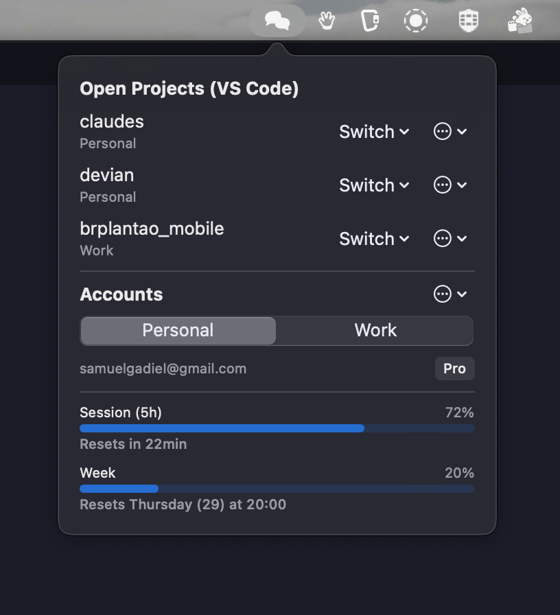
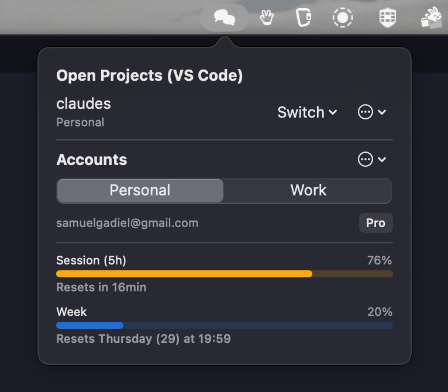
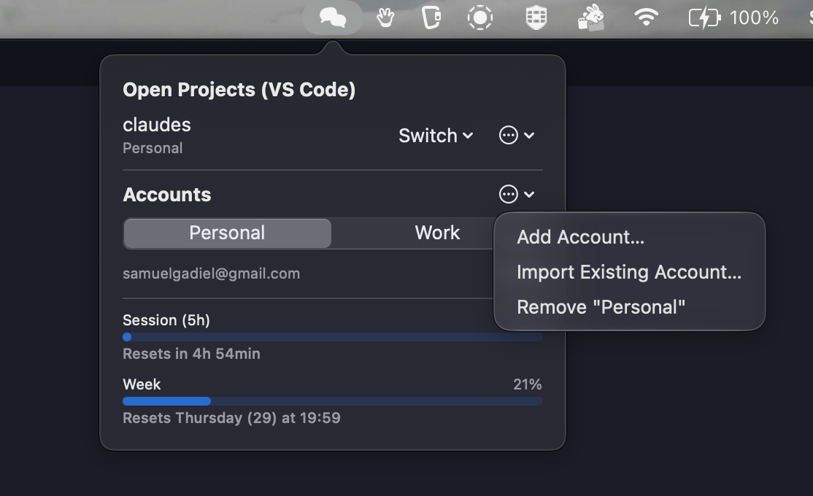
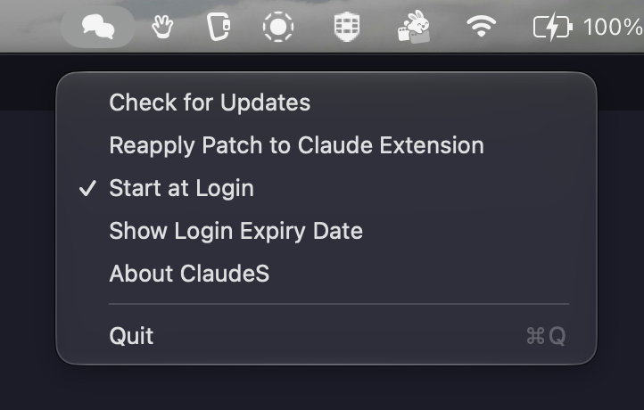
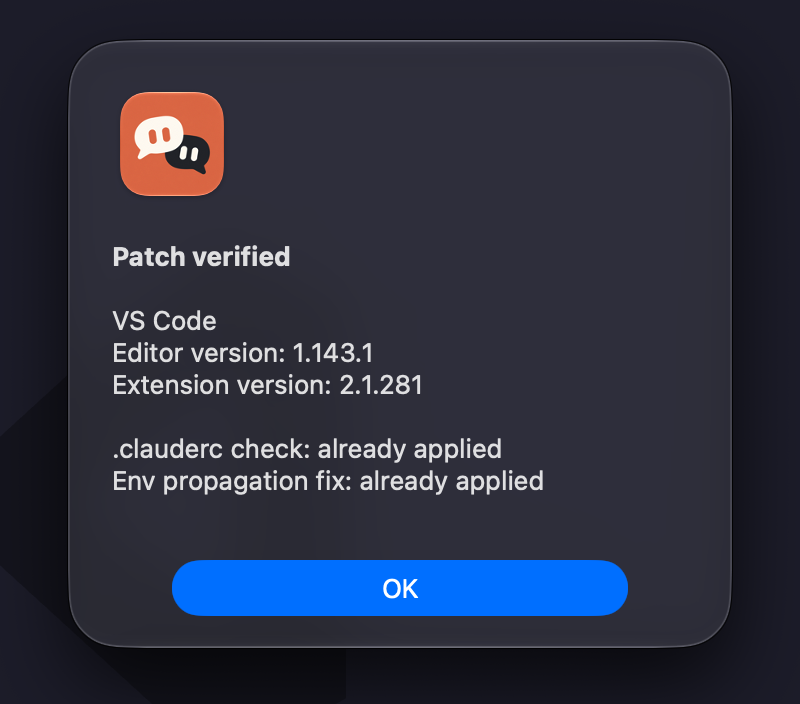

<div align="center">
  
  <h1>ClaudeS</h1>
  <p><strong>Run Claude Code under multiple accounts, side by side, without fighting VS Code over it.</strong></p>

  
  [](https://github.com/SamuelGadiel/claudes/releases/latest)
  [](https://github.com/SamuelGadiel/claudes/actions/workflows/ci.yml)
  [](LICENSE)
</div>

<br>

<table align="center"><tr>
  <td valign="top"></td>
  <td valign="top"></td>
</tr></table>

## Why

If you use Claude Code for both a personal and a work account — or more than one of either — you already know the pain: `claude /login` is one credential at a time, VS Code Profiles don't share your extensions or settings between them, and juggling `CLAUDE_CONFIG_DIR` by hand across terminals and editor windows gets old fast.

It gets worse the moment you actually hit a rate limit mid-task: switch accounts the usual way and the new one has no idea what you were just talking about, because each `CLAUDE_CONFIG_DIR` keeps its own session history. The "fix" is copying chat files between folders by hand just to keep working.

ClaudeS sits in your menu bar, keeps every account's credentials isolated, and makes each project remember which account it uses — not just in the terminal, but inside VS Code's own Claude extension too, with zero manual setup per project. Accounts also share the same session history, so running out of quota on one and switching to another never costs you the conversation you were in the middle of.

## Installation

```sh
brew install --cask samuelgadiel/casks/claudes
```

Open ClaudeS once from Launchpad — it installs the `cs` command for your shell automatically. No manual PATH setup.

<details>
<summary>Manual installation</summary>

Download the latest `ClaudeS-*.zip` from [Releases](https://github.com/SamuelGadiel/claudes/releases/latest), unzip it, and move `ClaudeS.app` to `/Applications`.

</details>

## Features

- **Multiple accounts, fully isolated** — each one gets its own `CLAUDE_CONFIG_DIR` and its own Keychain credential. Add a brand-new account, import one you already have, or remove one — all from the panel.
- **Per-project account, automatically applied** — switch a project's account once from the panel; a `.clauderc` file remembers it, and VS Code's Claude extension picks it up with no restart or manual config needed. No VS Code Profiles, no shared-extension headaches.
- **Chat history isn't account-bound** — every account shares the same session storage, so switching a project to a different account never loses the conversation history already there. Pick up exactly where you left off, no copying files around.
- **One default account** for every project that hasn't picked one yet.
- **Live usage bars** — 5-hour and weekly rate-limit windows per account, with reset times, right in the panel.
- **Usage notifications** — a native notification fires when an account crosses 75% or 90% of a window, and again once an exhausted window is available again — even with the panel closed, so you're not caught mid-task.
- **Reliable login status** — backed by `claude auth status`, not fragile direct Keychain reads, so you're not ambushed by a password prompt. A notification fires the moment a session actually expires.
- **A full CLI, not an afterthought** — see [Command line](#command-line) below.
- **Launches at login, installs its own CLI** — open the app once and `cs` is on your `PATH`; no `brew link`, no extra step.
- **Native and small** — Swift + SwiftUI, no Electron, no background daemon you didn't ask for.
- English and Portuguese (BR).

<table align="center">
<tr>
  <td valign="top"></td>
  <td valign="top"></td>
</tr>
<tr>
  <td colspan="2" align="center"></td>
</tr>
</table>

## Command line

ClaudeS isn't just a menu bar panel — `cs` is a complete CLI on its own, installed automatically the first time you open the app.

```sh
cs                             # runs claude with the current project's account (or the default one)
cs work auth login             # runs claude under a specific account, args passed straight through

cs list                        # registered accounts, login status, usage
cs add --name "Personal"       # registers a brand-new account
cs import --dir ~/.claude-work --name "Work"   # registers an account you already had set up
cs remove work                 # deregisters an account (asks for confirmation)
cs default personal            # account used by projects with no .clauderc

cs set work                    # sets this project's account (.clauderc)
cs status                      # every open VS Code project and terminal session, with its account

cs usage                       # rate-limit usage for every account
cs usage work                  # just one
```

Run `cs help` for the full reference.

## How it works

- **The `cs` CLI** runs `claude` with the right account's `CLAUDE_CONFIG_DIR` set, resolved from the current project's `.clauderc` or the default account.
- **Inside VS Code**, the official `anthropic.claude-code` extension doesn't natively support per-project accounts. ClaudeS applies a small, reversible patch to the extension's bundle (kept in sync across extension updates) that teaches it to check `.clauderc` first — see [`ClaudeExtensionJSPatcher`](Sources/ClaudeSCore/ClaudeExtensionJSPatcher.swift) for exactly what it changes and why.
- **Credentials** live in the macOS Keychain, one entry per account, exactly how the official `claude` CLI already stores them — ClaudeS doesn't invent a new credential format.
- **Session history** lives in a single shared directory (`~/.claude-shared-chats`) that every account's `projects/` folder symlinks into — chats belong to the project, not to whichever account happened to be active when they were written.

## Contributing

ClaudeS is a young project — the architecture is still taking shape, and that's as much an invitation as it is a disclaimer. If you want to help define conventions, propose a structure, or just fix something that bugs you, issues and PRs are welcome.

To build it locally:

```sh
git clone https://github.com/SamuelGadiel/claudes.git
cd claudes
swift build              # library + CLI, for quick iteration
scripts/build-app.sh      # assembles the real .app bundle into dist/
open dist/ClaudeS.app
```

No Xcode project — it's a plain Swift Package (`swift-tools-version:5.9`), so any recent Xcode or standalone Swift toolchain works.

`plans/` has the project's specs, research notes, and backlog (`plans/KANBAN.md`) — worth a skim before diving into a change, especially [`plans/specs/03-vscode-extension-patch`](plans/specs/03-vscode-extension-patch/spec.md) if you're touching the VS Code integration.

## License

[MIT](LICENSE)
